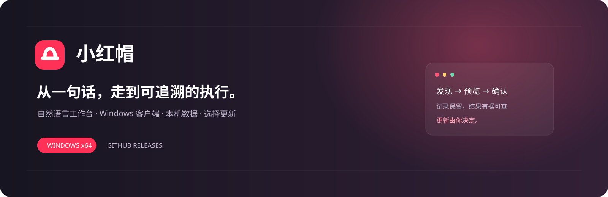
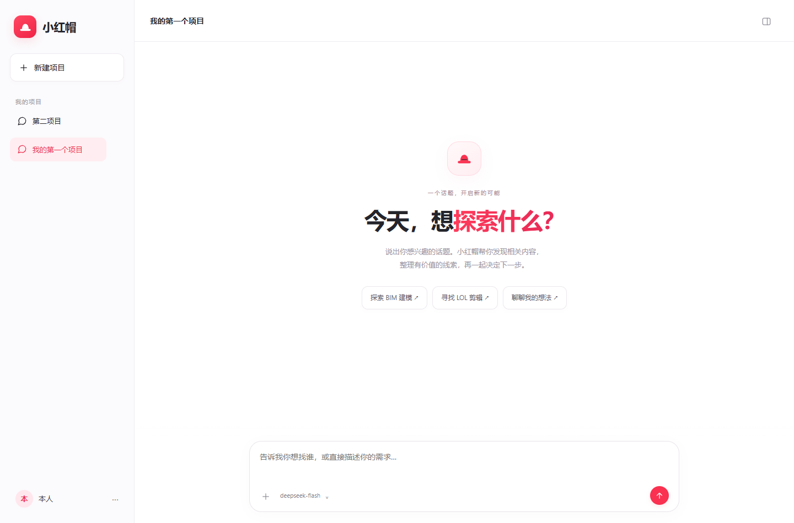
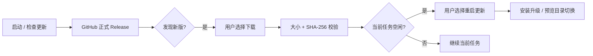
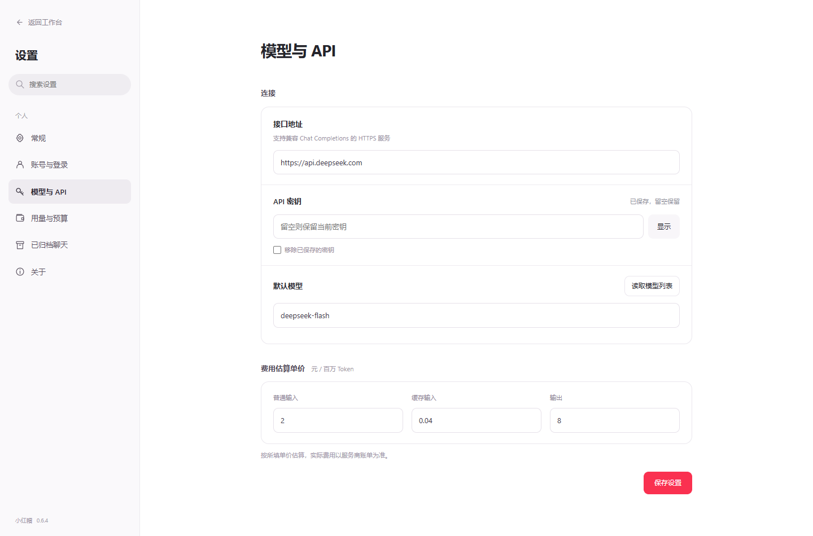
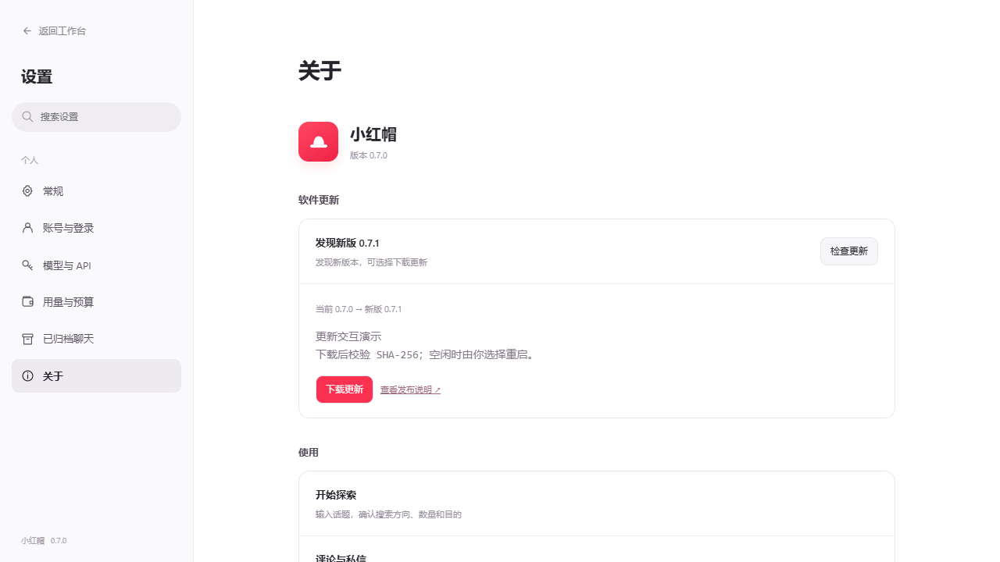

**说出需求，查看执行，确认结果。**

[下载安装版](https://github.com/Thedan-1/xiaohongmao/releases/latest) · [体验免安装版](https://github.com/Thedan-1/xiaohongmao/releases/latest) · [使用指南](docs/USER_GUIDE.md) · [版本记录](CHANGELOG.md) · [反馈问题](https://github.com/Thedan-1/xiaohongmao/issues/new/choose)

## 工作台一览

> 截图使用本机测试数据，不包含真实账号、密钥或客户记录。

| 对话与执行 | 记录与控制 | 桌面体验 |
| --- | --- | --- |
| 自然语言描述搜索方向与需求 | 项目对话、候选与草稿分别保存 | Windows 原生窗口 + WebView2 |
| 采集内容与可见评论，整理候选 | 发送前预览，支持明确的自然语言确认 | 安装版与免安装预览版 |
| 在右侧查看执行阶段与历史截图 | 联系记录去重，结果不明不自动重发 | GitHub Releases 检查与选择更新 |
| 小红书官方登录页面 | 归档、恢复和确认后删除 | 自填模型、API Key 与费用上限 |

**当前产品状态：** 小红书工作台已提供桌面包；淘宝店铺接入仍在实验验证阶段，尚未打通真实收发链路，不计入当前发行版能力。详见 [功能状态](docs/STATUS.md)。

## 三步开始

1. 在 [Releases](https://github.com/Thedan-1/xiaohongmao/releases/latest) 下载 `windows-x64-setup.exe`。日常使用推荐安装版；快速体验可选 `windows-x64-preview.zip`，完整解压后启动“小红帽预览.exe”。
2. 在官方登录界面连接账号，在 **设置 → 模型与 API** 填写自己的服务与密钥，并设置本机费用上限。
3. 在工作台描述需求。先核对候选、对象和文字，再决定是否执行。

公开发行包不预填 API Key，也不携带开发者的登录和聊天记录。AI 服务费用按配置单价估算，实际账单以服务商为准。

## 更新，也由你决定

启动检查会使用本机缓存；下载和安装需要用户选择。不会因为发布新版本而中断正在执行的任务。

| 安装版 | 预览版 |
| --- | --- |
| 更新原程序目录 | 切换到新程序目录，保留上一版目录 |
| 数据位于 `%LOCALAPPDATA%\Xiaohongmao` | 数据位于 `%LOCALAPPDATA%\XiaohongmaoPreview` |
| 首次安装有位置、协议与快捷方式选项 | 无需安装，完整解压即可体验 |

从 **0.7.0** 起内置检查与选择更新；更早的版本需要手动升级一次。GitHub 暂时不可达时，可以继续使用当前版本。

<b>查看模型设置和更新交互</b>

更新截图使用模拟的下一版本，展示交互，实际可用版本以 Releases 为准。

## 工程导览

| 位置 | 职责 |
| --- | --- |
| `app.py` / `studio.py` | 本机服务、项目与任务执行 |
| `studio-ui.*` / `settings-ui.js` | 工作台与设置界面 |
| `adapter.py` / `note_collector.py` | 页面适配与内容读取 |
| `project_store.py` / `chat_consent.py` | 联系记录、草稿与确认 |
| `updater.py` / `update_apply.py` | 版本发现、校验、更新交接 |
| `build-tools/Native*.cs` | 原生窗口、登录与生命周期 |
| `installer/` | 安装向导、协议、数据说明 |
| `test_*.py` | 隔离回归与边界验证 |
| `.github/workflows/` | CI 与发行构建 |

[架构说明](docs/ARCHITECTURE.md) · [本地构建](docs/BUILD.md) · [发布手册](docs/RELEASING.md) · [安全说明](SECURITY.md) · [贡献说明](CONTRIBUTING.md)

## 使用边界

平台登录、验证、权限和发送限制仍由平台决定。遇到验证或限制会停止，不提供绕过验证、隐藏自动化或换号续发的功能。回复监测依赖客户端运行和账号状态，不承诺退出或休眠后继续监测。

本项目公开源码用于审阅与协作，**不等同于授予开源许可证**。权利说明见 [LICENSE](LICENSE)。
