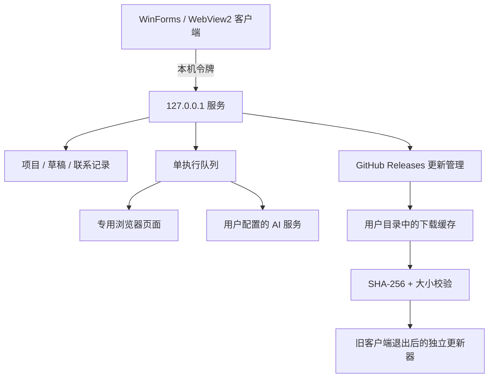

# 架构与状态边界

程序文件与用户文件分离。AI Key 只保存在本机配置，GET 状态不返回密钥；本机服务校验 Host、令牌和 POST Origin。公开下载不含 Key 或浏览器资料。

## 联系记录

草稿、确认、提交与结果是不同状态。提交前记录领取，重复提交由唯一记录和状态变更拦住。发送不明不自动重试；截图用于展示实际观察结果，不被当成平台投递保证。

## 更新交接

1. 优先读取配置仓库 `/releases/latest/download/update.json` 的公开静态清单，校验仓库与格式。GitHub 的 latest 路径不选草稿和预发布；老版本缺少清单时才回退到 Releases API。
2. 按安装版 / 预览版选取不同资产。检查名称、官方来源、大小与 发布清单 SHA-256。
3. 下载写入临时文件，完整校验后才成为可安装包。
4. 重启前在任务接收锁内确认空闲，并冻结新任务、请求安全退出。
5. 更新器和运行环境复制到用户缓存，等待旧原生进程退出后再操作程序目录。
6. 安装版运行升级安装程序；预览版检查 ZIP 路径与文件清单，完整写入新目录，最后切换指针。

预览版保留上一程序目录和 `current-app.previous.txt`。下载或校验失败不会修改旧程序；启动失败可恢复原指针。尚未提供通用的运行时健康检查回滚，不将“进程启动”表述为全部业务可用。

TLS 与同一 Release 的资产校验清单用于来源和完整性核对；它们不等同于独立发行签名。当前安装包未提供代码签名，Windows 可能显示未知发布者提示。
